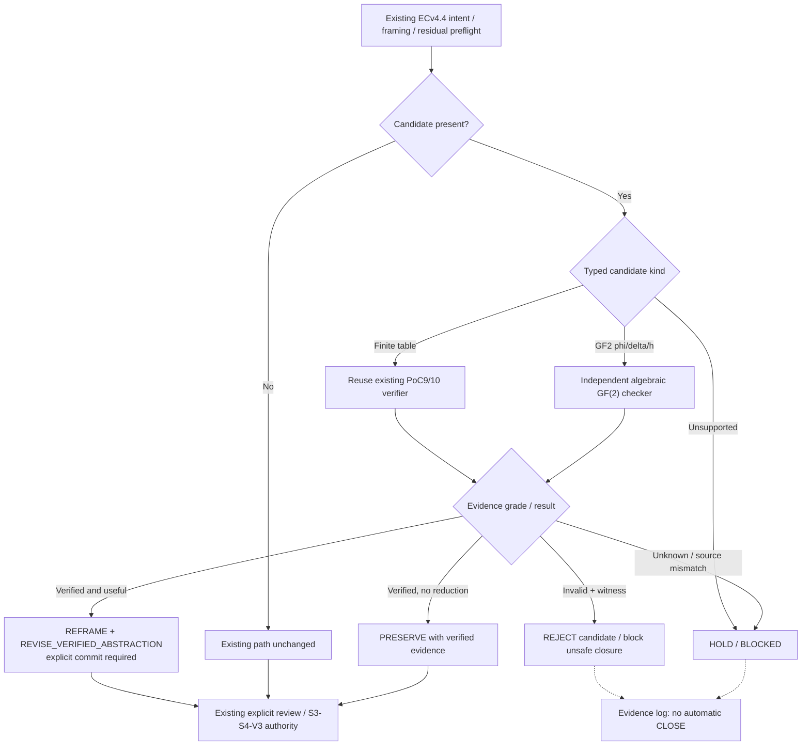

# ECv4.4 REABSTRACT — 修正版・実装用決定プロンプト

状態：**SPEC_FINAL / IMPLEMENTATION_INCOMPLETE**（2026-11-07）。
本書はECv4.4改修の実行指示であり、ROOT-GEN-001の原理発見研究と切り離す。決定仕様は完了を意味しない。

## 現物と境界を先に確認する

- 実装対象：[GPT-EC-Closure-Engine / `ECv4.4-candidate`](https://github.com/mokumaisancho/GPT-EC-Closure-Engine/tree/ECv4.4-candidate) を基底とする [既存Draft PR #40](https://github.com/mokumaisancho/GPT-EC-Closure-Engine/pull/40) の `research/gen001-verified-abstraction-20261106`。
- 既存 `01_repo/src/v4/ec_behavioral_abstraction.py` は有限遷移表の到達可能部分に対する独立の同値性・最小性ゲート、`ec_behavioral_runtime_binding.py` は登録元の実行関数と表の照合、`v4_4_control.py` は候補ありの場合の明示的な `REFRAME`・審査要求を既に持つ。**これらを別名で重複実装しない。**
- 既存候補プロトコル `EC_V4_4_BEHAVIORAL_ABSTRACTION_CANDIDATE_V1` は有限振る舞いモデル用。新規 `ABSTRACTION_CANDIDATE_V1` は `phi/delta/h` を持つ**数学的座標変換**候補用の型付き入口とする。両者を取り違えない。
- 既存 `evolve_framing`、residual、intent保護、authority-bound exemption、V3 permit/postflight/final-closure、候補がない場合の既存フローを変えない。

## 原課題とこの変更の役割

**ECの不足**：metadataの説明不整合がなくても、未来を保存するより小さな表現が存在することがある。しかし現在のREABSTRACT/Framingでは、その数学的候補の受入・検査・検証済み審査要求が標準化されていない。

**EC側の責任**：外部または上流で発見された候補を、信頼された実行対象・作用域・出力契約と照合し、正しい候補だけを審査対象に載せる。**未知の`phi`を自動発見する責任は本変更の範囲外**（ROOT-GEN-001 Issue#71の発見ACとして別管理）。metadataスコアを数学的証明に格上げしない。

## 実装要求

### R0. 既存の差分監査を先に行う
PR #40の実際のコード・テスト・baseとの差分を確認し、以下を **EXISTS / PARTIAL / MISSING / NOT_RUN** に分類する。EXISTSなら変更せず再利用し、MISSINGだけを最小変更で実装する。実行環境がなく内容が読めない場合は推定で実装しない。

### R1. `ABSTRACTION_CANDIDATE_V1` 型付きエンベロープ
必要なフィールド：
- protocol/version、candidate ID、`source_ref`、正規化されたソースのdigest、framing/intentのdigest。
- domain、許可reset/初期状態、action scope、output contract、対象状態空間と証明範囲。
- `phi`（元状態から新座標）、`delta`（各操作の新座標遷移）、`h`（出力読出し。出力恒等の場合のみ省略可）、候補の状態数/記述量。
- proof claim、使用した数理領域・判定方式、明示的なbudgetと未検証範囲。
- 候補自身が記載したPASS・source runtime・authorityは**一切信頼しない**。

入口で `kind=FINITE_OBSERVABLE_MACHINE` は既存有限モデルへ、`kind=GF2_LINEAR_QUOTIENT` は新規数学的検証へディスパッチする。サポートしていない領域は `HOLD/BLOCKED`。型・作用域の混同を許さない。

### R2. 候補と独立した検証
信頼側が候補と別に登録したソース・操作・出力・ランタイム識別・予算から検算する。

- 未来保存：`phi(T(x,a)) = delta(phi(x),a)`。
- 出力保存：`O(x) = h(phi(x))`。
- domain/action/reset/output/framing/intent/version mismatch は fail closed。
- `GF2_LINEAR_QUOTIENT` は行列恒等式とGF(2)ランク・閉包を用い、128bitで `2^128` 全列挙しない。独立検証器が候補生成と同じ検算結果を自己申告として受容しない。失敗時は行列差の非零列から具体的 `x,a` の反例を組み立てる。
- 既存有限モデルは登録済み到達可能状態と許可操作を対象に、直積BFSと独立最小化を再利用する。表ハッシュはライブコード真正性の代替ではない。
- 予算切れ・ランタイム出典不明・独立検証不能は **HOLD/BLOCKED**。`PASS`や`PRESERVE`への自動降格を禁止。
- 証明の作用域外には全く拡張しない。証明器/候補の更新後は証拠を再検証。

### R3. controller経路と権限分離
- **候補なし**：既存 `evolve_framing`、residual、intent、S3/S4、V3を**バイトレベルの出力契約・観測挙動で不変**に保つ。
- **正しい候補 + 意味のある縮約**：既存のトップレベル `status=REFRAME` を保持し、`framing_revisions` の型付き操作として `selected_operation=REVISE_VERIFIED_ABSTRACTION` を発行。既存の `requires_explicit_commit=true` を保持し、実行・新しいframingの採用・CLOSEは自動化しない。既存consumerがそのフィールドを受け取れないなら互換の別フィールドを設け、既存スキーマ/呼出先との適合性を先に確認する。
- **証明不合格**：`REJECT` 相当の候補審査ブロックと反例を返す。無検証候補を無視して既存 `CLOSE` に進まない。
- **予算/真正性/依存先不足**：`HOLD/BLOCKED` の理由と不足証拠を残す。黙って成功扱いにしない。
- **同値だが縮約利益なし**：検証済み`PRESERVE`証拠として記録するが、候補が存在し数学的に不備があるケースとは区別する。
- 既存framing revisionやresidualの禁止条件の優先順位を変更しない。S3の単一行動・複数候補集合の契約を黙って置換しない。

### R4. 費用台帳の分離
`source/state size`, `phi/delta/h size`, discovery/acquisition、初期`phi`計算、1-step runtime、独立証明時間とメモリ、必要な利用回数、direct optimized source baselineを別記する。**コストは測るまで未測定**。C6や汎用的な速度改善が完了したと宣言しない。

### R5. テスト・出口
- 候補不在時の既存挙動、元のframing/residual優先順位。
- GF(2)有効候補（PoC4の128→2の制限操作）を独立検算し、審査要求のみ発行。
- 誤`phi`、誤`delta`、誤`h`、追加された隠れ成分のprobe操作、source digest mismatch、候補による偽PASS/偽権威、タイムアウト、証明予算切れ、失効したframing/intentをすべて否定系で試す。
- 既存finite-automaton PoC9/10と新`GF2_LINEAR_QUOTIENT`双方で出力契約の互換性を検査する。
- `01_repo/tests/` の既存native全回帰、実際のS3/S4入口、V3 permit/postflight/final-closureを**スタブなし**で走らせ、PASS/FAIL/SKIP/NOT_RUN・タイムアウト終了コードを分ける。未実行ならDraft維持、マージ・本番採用禁止。
- 変更は既存Draft PRの研究ブランチに限定。基底ブランチ・本番権限・CI有効化は独断で変更しない。

## 現行フローを保持するMermaid

## 納品契約・完了条件
1. 既存実装の監査表と新規変更の最小差分。
2. 型付きエンベロープ・検証器・adapterの入出力仕様、反例・証拠の形式。
3. テストのケース別結果と、**未実行を残したままの**現在のAC照合表。
4. 技術上の依存／不足証拠、差分を反映したMermaid、既存Draft PRへのリンク。
5. エビデンス不足が残る場合は`INCOMPLETE`と報告。実装済みと推測しない。

**最終判定**：本プロンプトはECv4.4修正仕様の決定版。実装・本番PASS/原理研究の完成を意味しない。ROOT-GEN-001/C6へ作業の主線を戻す。
