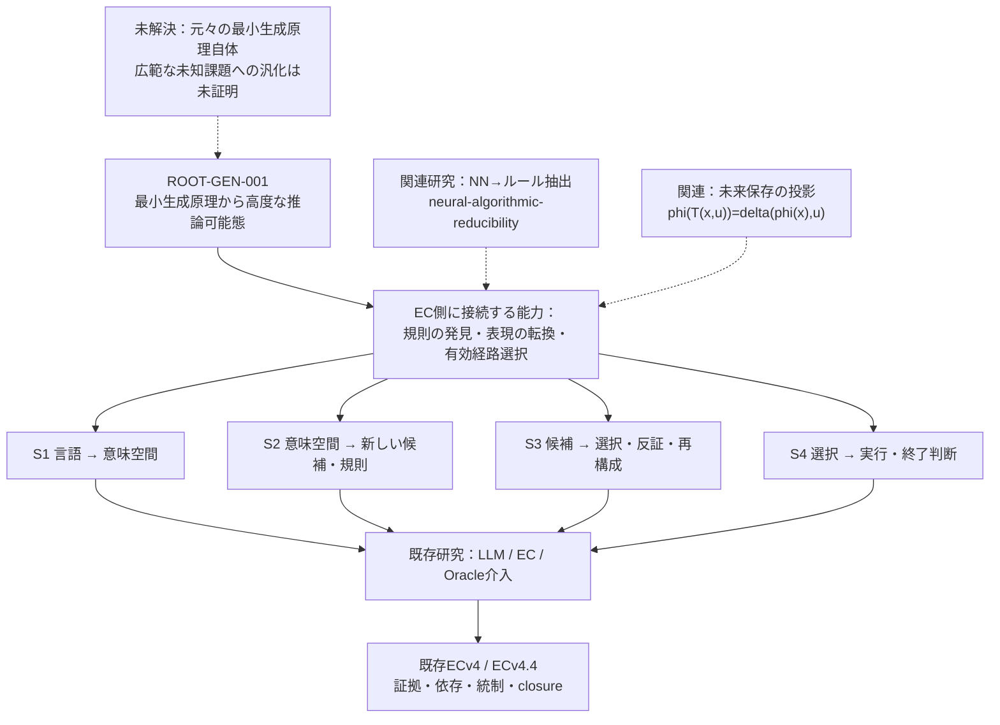

# 既存 ECv4 / ECv4.4 / S1–S4 研究との接続

## 0. 既存正本の確認と用語

ユーザー発話「ECB4 / ECB4.4」は、既存資料では **ECv4 / ECv4.4** と表記されているため、本資料は既存コード・AC表記に統一する。

- ECコード正本: [mokumaisancho/GPT-EC-Closure-Engine](https://github.com/mokumaisancho/GPT-EC-Closure-Engine) の [GPT-EC-V4ブランチ](https://github.com/mokumaisancho/GPT-EC-Closure-Engine/tree/GPT-EC-V4)。
- 機能的置換境界を測る研究正本（今回の格納先）: [mokumaisancho/LLM-EC-Layerwise-Ablation](https://github.com/mokumaisancho/LLM-EC-Layerwise-Ablation)。
- NN/規則縮約の補助研究: [mokumaisancho/neural-algorithmic-reducibility](https://github.com/mokumaisancho/neural-algorithmic-reducibility)。

今回の新設記録は、既存正本を置換する新規ランタイムでも、S1–S4の受入基準を再定義するものでもない。

## 1. 以前から解こうとしていたもの

[LLM-EC-Layerwise-Ablation/ISSUE_STATEMENT.md](https://github.com/mokumaisancho/LLM-EC-Layerwise-Ablation/blob/main/ISSUE_STATEMENT.md) には、軽量LLMが意味のある候補を出せるとしても、選択・早期終了・再構成・矛盾処理で失敗する原因がどこにあるのか、という原課題が既に登録されている。

[ACCEPTANCE_CRITERIA.md](https://github.com/mokumaisancho/LLM-EC-Layerwise-Ablation/blob/main/ACCEPTANCE_CRITERIA.md) にはLLM/EC/Oracleの同一上流入力・各層の介入・誤帰属防止・大型LLM不要のPhase1が定義されている。

[PHASE1_MVP_AC_DEPENDENCY_TCC_2026-10-03.md](https://github.com/mokumaisancho/LLM-EC-Layerwise-Ablation/blob/main/docs/PHASE1_MVP_AC_DEPENDENCY_TCC_2026-10-03.md) によれば、当時の基準ではECv4.4-native S3/S4の比較に対し、決定論的・oracle-blindなnative adapter、同一入力ハッシュ、固有の変更箇所と証拠境界を要求する。ECの残余検知だけでS3/S4全体を実装済みと呼ぶことはできない。

EC側の [README (GPT-EC-V4)](https://github.com/mokumaisancho/GPT-EC-Closure-Engine/blob/GPT-EC-V4/README.md) では、V4は既存のV3 permit/postflight/closureを残した外側の決定制御と定義されている。

## 2. 今回の原課題は「既存研究の上位にある」

## 3. 重複と新規の境界

| 能力 | 既存で何があるか | 今回の新しい問題 | 対応 |
|---|---|---|---|
| 目標・依存・証拠・終了の管理 | ECv4確立済みの設計と実装 | 推論原理の発見ではない | ECを管理に再利用し、科学的能力とは混同しない |
| 候補の判定・再構成・終了 | S3/S4およびECv4.4 native の部分的機能 | 無限の候補から有効経路を作る**初期原理** | S3/S4研究の境界を保ち、上位仮説へ接続 |
| 新しい意味・演算・構造の発見 | S1/S2研究・追加分解の試み | 最小の生成規則から意味空間が発展するか | 未実証の原課題としてOPEN |
| NN内部処理の規則化 | neural-algorithmic-reducibilityのC0限定実績 | NNを出発点にせず構造を初めから構築 | 既存結果は比較研究として利用 |
| 次元の投影と未来の保存 | PHYSICS_AND_EPISTEMOLOGY.mdに数学的な区別が登録済み | 実際にどのphiで能力の急変が生まれるか | 既存の式を再利用、実証はOPEN |
| 自己生成による能力拡張 | ECには候補・依存管理はある | 知識以前の推論規則自体を自己形成できるか | 研究の新しい中核仮説 |

## 4. ECv4.4とのトレーサビリティ

既存のPhase1研究でのS1〜S4と今回の研究論点の対応:
- **S1**: 観測・言語・状態から意味のある変数を見つけられるか — Q12 / T07（表現変換）。
- **S2**: 初期規則から未知の候補、法則、処理経路を生成できるか — Q07/Q09 / T01/T02。
- **S3**: 生成された候補に制約・反証・選択・再構成を適用できるか — Q10/Q11 / T04/T05。
- **S4**: 解の検証、次の探索への反映、適切な終了判定ができるか — Q10/Q13 / T10/T11。
- 既存の原課題との重複点は、**選択/再構成を有限の決定論的操作にできるか**、というS3/S4の部分。今回新規に問うのは、それを可能にする**最小の初期生成器と表現空間**。

## 5. 既存実績を誤引用しない
- neural-algorithmic-reducibilityのC0有限分類の正しさは、未知のLLM推論回路の完全置換ではない。
- S1/S2/S3/S4に分析・PoCが存在することは、ECv4.4が汎用的な法則発見器に到達していることを意味しない。
- EC側の証拠ゲートは、正答データの独立性や科学的結論の真実性を自動保証しない。
- **本記録での新規実験はNOT_RUN、受入条件は変更なし、既存Issue/PRは変更なし。**

## 6. 再開時の単一の判断課題
既存の4層機能を活用してよいが、真の初期構造を探す研究は分離して判定する。

**投影 phi と局所遷移 delta の候補について、(a) 出力・未来保存、(b) 有用解への到達、(c) phi・delta・検証器・環境を含む総記述長と有限資源コストを比較できるか。**

この3点が同じ実験で検証できるなら、最小の機構を追加設計する根拠となる。外部LLMは参照モデルに限り、正解そのものは独立の形式的検証で判定する。

参照: [README](README.md) / [論点Mermaid](ISSUE_FLOW.md) / [技術Mermaid](TECHNICAL_DEPENDENCIES.md) / [論文台帳](PAPERS_AND_CLAIMS.md)。
