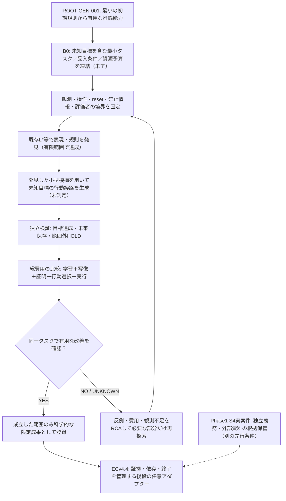
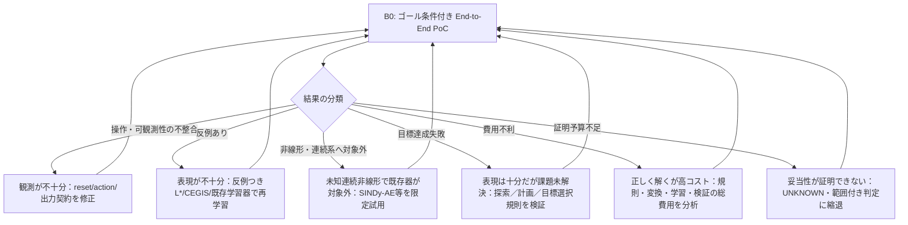

# GEN001 — PoC1〜13の証拠監査、単一クリティカルパス、次のPoC仕様

> **2026-11-07の更新**: 本書「最短の次の一実験」は当時の提案であり、今の優先順位では**撤回／延期**。元研究の受入条件を変えず、[最新版の技術依存図](TECHNICAL_DEPENDENCIES.md#2026-11-07-最新の依存関係本線判断現行以下aeは歴史的概念的な図)と[ACTIVE_DECISION](ACTIVE_DECISION.json)を最新の意思決定正本とする。直近k0-L*は256→4の振る舞い学習PASSだが、元raw投影の`phi`は未学習。Issue#71 C6はP4線形経路で既存`phi`から評価する。全費用比較は未実施。

日付: 2026-11-07 (JST) / 原課題: [ROOT-GEN-001](README.md) / [Issue #71](https://github.com/mokumaisancho/LLM-EC-Layerwise-Ablation/issues/71) / 別研究 [Phase1 #1](https://github.com/mokumaisancho/LLM-EC-Layerwise-Ablation/issues/1)

**状態: EVIDENCE_AUDIT / 次の実験は設計・判断のみでNOT_RUN。既存のAC・コード・Draft PRを変更しない。**

## 0. 結論 — 直前の「決定的ブロッカー」認定の訂正

[PoC13](poc13_authority_gate_2026-11-06/REPORT.md)で挙げた外部義務目録の完全性は、**Phase1 S4の実案件に対する正当なCLOSE**には必要だが、**GEN001の有限・合成・閉世界の生成原理研究を続けるための先行ブロッカーではない**。問題階層を混同し、研究の最優先課題を誤選択していた。

GEN001の原課題: **大型LLMを初期に用いず、最小初期規則／表現変換から、有限予算で未知の課題への有用な推論・解決を発生させられるか。** 
これまでの実測は「未来保存の小型表現の発見」「局所的な独立検証」「ECの証拠・終了管理」の３種類に集中し、**小型表現が未提示の目標に対する行動選択・規則適用・問題解決を改善するという因果的な連鎖**は未実測である。

**GEN001の単一P0ブロッカー＝タスクに結びついた end-to-end 能力／総コスト評価契約がまだ存在しないこと。** 
適用限界（非線形性、未観測状態）や総費用の課題も重要だが、何を「有用な推論」として成功判定するかが決まらなければ、既存の縮約・検証・制御をいくら進めても原課題への距離が測定できない。

## 1. 主要な証拠と対応する主張の限界

| 参照 | 実際の結果 | 支持すること | 支持しないこと |
|---|---|---|---|
| [PoC4/6](poc/README.md) | GF(2)既知128変数 → 2座標。独立した行列証明あり。隠れ変数へアクセスする操作を追加すると128 | 既知線形系の最小未来保存座標の自動生成 | 未知連続非線形法則や有用な目標達成 |
| [PoC7](poc/POC7_FINDINGS.md) | 内部座標を知らず、固定reset・操作の下で128bit合成非線形系から4状態の**到達可能**観測機械を学習 | 再初期化・会員問い合わせ可能な有限ブラックボックスの振る舞い抽象化 | 真の元座標の復元、任意reset・操作、目標を自律生成／解決する能力 |
| [PoC7異常系](poc/POC7_FINDINGS.md) | 40状態必要な系を、弱いEQテストで7状態と誤終了。独立検算で反例 | 学習器停止≠証明 | 任意の未知実系で強い同値オラクルが得られるという保証 |
| [PoC8〜10](poc/POC8_FINDINGS_2026-11-06.md) | 条件付きの未来保存・最小性・実行関数照合。EC [Draft PR #40](https://github.com/mokumaisancho/GPT-EC-Closure-Engine/pull/40) | 既知の有限遷移源に対する安全な証拠付き候補の審査境界 | 発見アルゴリズムそのもの、全EC SUITE、実S3/S4・V3実行 |
| [PoC9](poc/POC9_NATIVE_ECV44_INTEGRATION_2026-11-06.json) | 8状態→4状態だが、Python遷移速度比 **0.961x** | 状態数削減と実時間短縮が同義でない | 学習・証明・表現変換を含む総費用改善 |
| [PoC12](holdout_s4_2026-11-06/REPORT.md) | 7項目だけのS4既存規則は合成64件で16誤CLOSE。識別不能な可視入力16対 | 元入力契約でのS4判定が情報不足 | GEN001の新規規則発見の失敗・原因 |
| [PoC13](poc13_authority_gate_2026-11-06/REPORT.md) | 模擬信頼根を別に固定すると合成64/64、11異常系制御 | 信頼済み完全な義務・証拠を前提とすれば局所的な終了安全性を確認可能 | 実世界の義務全量・真正な独立Gold・原理発見の成功 |
| [独立W4B/C AC](https://github.com/mokumaisancho/LLM-EC-Layerwise-Ablation/blob/main/docs/ISSUE1_W4B_W4C_INDEPENDENT_PROOF_AC_V1.md) | 外部文書と第三者Goldは計画段階、未取得 | Phase1実案件のCLOSEには外部根拠が必要 | GEN001の合成・閉世界PoCの実行前提 |

Issue #71 のC1〜C3はGF(2)の条件内PASS、C4/C5はDraftアダプター段階、C6は総費用未達、C7は既存SUITE未実施。Issueのチェックリスト本文は未更新。PoC1〜13の数字を同一母集団・同一ACとして足し合わせてはいけない。

## 2. 原課題に必要な条件の完全性監査

これまで提案された「反例なら再探索／義務不足なら保留／遅ければ不採用」は**後段の障害対応**であり、前段の問題定義・情報取得・発見・有用性・独立性が抜ける。次の7条件を、異なる性質のゲートとして区別する。

| 分類 | 必要条件 | 現状 | GEN001への依存性 |
|---|---|---|---|
| A 目標 | 「推論・解決」を観測可能なタスク、目標、基準解、予算とする | **欠落**。状態縮約と終了安全性の評価はあるが、未知目標への行動選択実験なし | **P0: 全工程の前提** |
| B 可観測性 | reset、action、観測、未知状態、アクセス権を固定。何を再現可能か識別 | 有限系では部分確定。一般系は不可識別条件が残る | P0の入力契約に含める |
| C 発見 | 巨大LLM教師・内部規則・Goldを見ずに候補規則／状態を得る | L*で限定PASS。自己生成の新しい一般規則はOPEN | A後に検査 |
| D 妥当性 | 予測だけでなく、未提示の**目標への行動選択**が正しいか独立判定 | 出力同値性の限定PASS、目標達成は**未測定** | **P0の主な実測対象** |
| E 汎化 | 学習にない目標・初期状態・操作・環境で能力を測り、範囲外ならABSTAIN | 固定resetの同値性のみ、外挿は未証明 | P0で限定保持試験 |
| F 便益 | 初期規則＋座標写像＋探索＋検証＋学習＋環境の総記述長と実測資源を比較 | 8→4で実行遅延の悪化例、E2E費用なし | P0で同一実験測定 |
| G 統制 | 候補の証拠・版・独立性・反例・終了判定を管理し、権限境界を保持 | PoC8–13で限定PASS。EC native統合未完了 | 後段のみ。原理発見への先行依存ではない |

**Open-worldの「未知の全義務が存在しない」絶対的な証明は要求しない。** 合成PoCは閉じた仕様上の完全性を検証可能。現実の自然言語課題を終了認定する場合のみ、既存W4B/W4Cの独立資料・条項→義務の監査・保管人を満たす必要がある。

## 3. 問題の依存関係：根本目的に対する直列のクリティカルパス

## 4. 技術上の分岐：失敗が確認されたときだけ局所解決

## 5. 最短の次の一実験（まだ実行していない）

**PoC14／B0: 学習された小型機構が、未提示の目標に対して正しい経路を選び、総コストで優位か。**

既存PoC7の「内部座標を隠した有限の128-bit合成非線形系」を再利用。推論器側に与えるのは**reset・操作・観測出力と問い合わせ結果のみ**。元の状態遷移関数、真の潜在座標、独立評価者のGold、先に用意した目標解列は隠す。評価者は秘密の状態系と複数の独立初期状態を保持。

- 学習段階：既存L*で振る舞いの小型モデルを学習。学習器の反例探索は公開問い合わせのみとし、**全到達状態を知る厳密EQオラクルを学習側へ渡さない**。既存PoC8のoracle-assisted L*の成績と混同しない。
- 課題段階：学習終了後に**未提示の目標**（特定の観測列に到達する複数ステップ操作、反事実の条件付き操作選択）を開示。小型モデル上で経路を生成し、同じ計算資源予算の元状態による探索・非学習対照と比較。単なる状態数削減ではPASSとしない。
- 独立評価：解の可否と目標達成を、学習器から隔離した元状態系で検証。学習用の成功判定と外部Goldを分離。範囲外の追加操作／resetはHOLDとし、スコープ拡張の自動PASSを禁止。
- 測定：未知目標ごとの成功率、探索ノード数、学習問い合わせ数、失敗時の反例、状態・規則・写像のサイズ、総実行時間、検証費用、同一予算下の基準法との差。成功条件・ベンチマーク選択・比較予算は**実行前に固定**し、結果から変更しない。
- 出口：未知目標の正答が維持され、限定スコープの将来保存が裏付けられ、**ある明記した運用回数で実測総コスト改善**があれば限定PASS。状態数だけ小さい／ゴールに達しない／証拠不十分／合算で改善しない場合は各原因別FAIL/HOLD。大規模LLM相当の推論能力は主張しない。

**このPoC14は「任意の未知問題の一般推論能力」を証明するものではなく、PoC7の表現学習と原課題の有用な経路選択の間にある未実証の接続を最短で試すための決定的な検証**。

## 6. 今すぐ進めてよいこと／いけないこと

- 進めてよい：既存PoC7の学習コードとPoC4/6の数学的検証器を流用してPoC14の**事前登録・評価環境と測定**を実行。有限状態の条件付き成果を維持。
- 先行不要：万能非線形発見器の独自構築、実世界の全義務の無条件証明、ECv4.4を一般原理発見器に改造すること。
- EC本番に必要だが現PoCの独立ブロッカー：独立W4B/W4C資料・証拠、実際のS3/S4/V3通し試験、Draft PR #40の新コードに対する既存SUITE全実行。**未完了は未完了のまま保持**。

参照原課題：[README](README.md) / [議論変遷と依存](ISSUE_FLOW.md) / [技術依存](TECHNICAL_DEPENDENCIES.md) / [PoC7](poc/POC7_FINDINGS.md) / [PoC9総費用](poc/POC9_NATIVE_ECV44_INTEGRATION_2026-11-06.json) / [PoC12/13](holdout_s4_2026-11-06/REPORT.md) / [Phase1の別完了条件](https://github.com/mokumaisancho/LLM-EC-Layerwise-Ablation/blob/main/docs/ISSUE1_W4B_W4C_INDEPENDENT_PROOF_AC_V1.md)。

## 2026-11-07: next-step correction after capability-first review

The earlier §5 proposal to test unfamiliar objectives immediately is **DEFERRED, not the present P0**: it skipped direct use of the already learned model and several feasibility prerequisites. See [current decision and 24-case derived observation check](MODEL_AFFORDANCE_NEXT_DECISION_2026-11-07.md). The immediate next measurement is **existing repeated future-output prediction**, comparing source execution with the 4-state learned model while accounting for learning, independent verification and repeated operation costs. The current model has a one-action state-discrimination property in an *unknown-state* setting, but the existing fixed reset/known action history makes performing such diagnostic probes unnecessary. Return to novel goals/planning only after the smaller capability's actual usefulness is established and a concrete need emerges.
