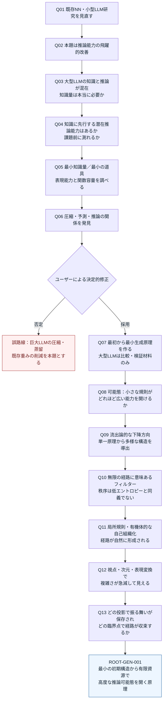
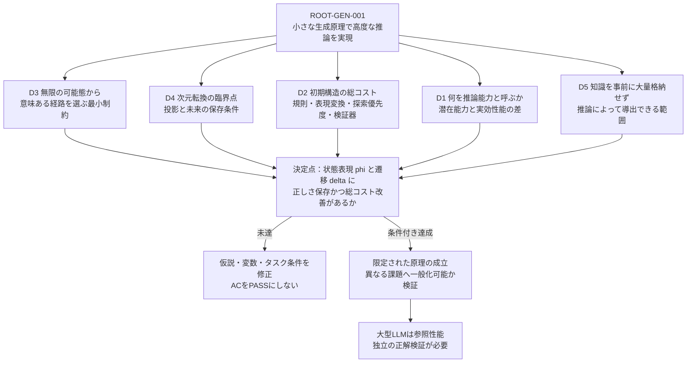

# 課題の変遷と依存関係（Mermaid）

> **図の用途**: 本書のMermaidは原課題への議論の変遷・論理構成を残す歴史的な図。PoC16・k0-L* 256→4の結果、Issue #71 C6に必要な`phi`と入出力予測器の区別、現在の最短実行経路は[現行技術依存図](TECHNICAL_DEPENDENCIES.md#2026-11-07-最新の依存関係本線判断現行以下aeは歴史的概念的な図)を正とする。Q-A〜Q-FのOPENは研究全体の未解決であり、すべてを次の作業の直列必須条件にしない。

2026-11-05までの本スレッド内の議論を、単なる時系列ではなく「何が否定・修正され、何が最終的に残ったか」で整理する。全ノードは議論記録であり実証済みとは限らない。

## A. 議論の変遷 — 誤った出発点の排除を含む

## B. 原課題の論理依存 — 問題を無限分割しない

### 独立して扱う主な問い
| ID | 問い | 判定可能な形 | 状態 |
|---|---|---|---|
| Q-A | 原理が小さいだけで能力が大きいか | 規則の長さ・課題族・有限計算資源 | OPEN |
| Q-B | 知識が少なくても未学習の法則を導出できるか | 新規構造への外挿、独立正解 | OPEN |
| Q-C | 潜在能力を課題実施前に知れるか | 理論容量・内部構造指標と独立テストの一致 | OPEN |
| Q-D | どこで次元転換が起こるか | 投影候補に対する状態数・誤差・総計算量の変化 | OPEN |
| Q-E | 外から与えたフィルターなしに有効経路を形成できるか | 制約生成、反例、費用、正しさ | OPEN |
| Q-F | ECv4.4に何が既にあるか | 既存コード・AC・native境界・S1〜S4でのギャップ | PARTIAL_EVIDENCE |

## C. 本題に従属しないもの
- 既存のNNの圧縮率最大化・蒸留率最大化は主要課題ではない。
- 普遍計算の可能性を示すだけでは、有限資源での高度推論の成立証明にならない。
- 神秘主義・流出論・人間を受信機と見る説明は着想の比喩として記録するが、非物理的計算機構の実在は科学的に未実証。
- 研究を無限に細分化することや、論文の説明のみで完了扱いすることは避ける。

参照: [技術依存](TECHNICAL_DEPENDENCIES.md) / [論文台帳](PAPERS_AND_CLAIMS.md) / [EC接続](ECV4_4_4_TRACE.md)。
