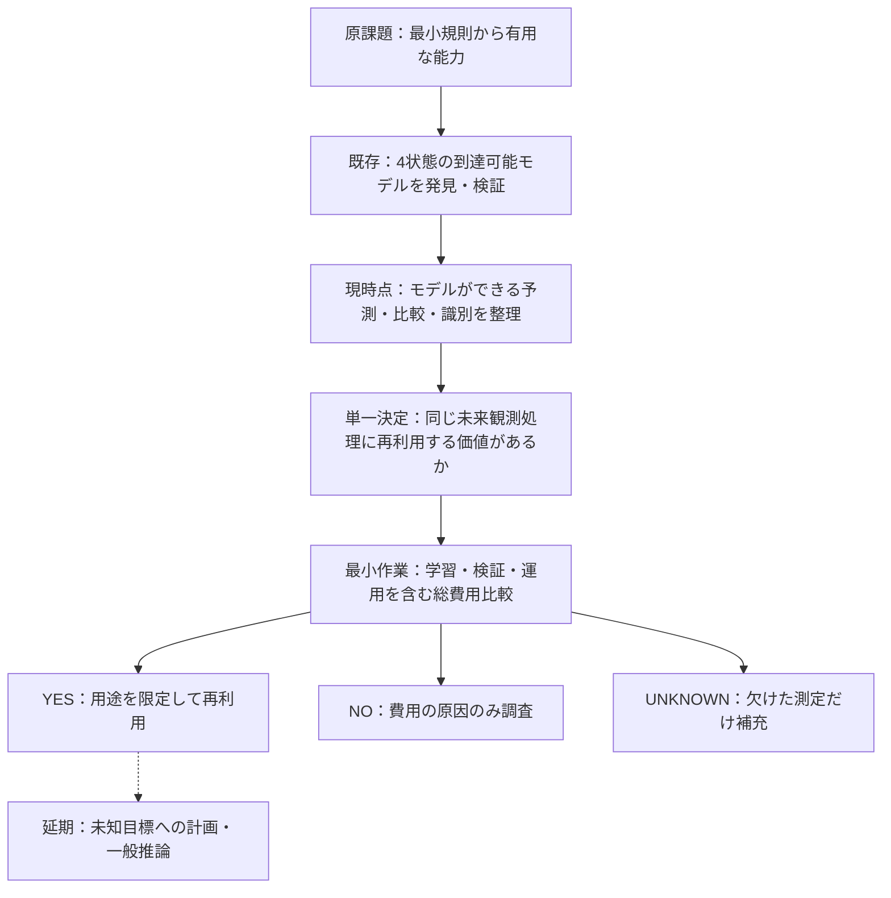

# GEN001 — 発見した4状態モデルで何が可能になったか／本線の次の1アクション

Date: 2026-11-07 / 原課題 [README](README.md) / [PoC7の実行結果](poc/POC7_FINDINGS.md) / [Evidence-to-next-action skill](../../.agents/skills/evidence-to-next-action/SKILL.md)

**判定：これまでの「未知目標を解くPoC14」は現段階には過大。新しい研究目標を立てず、すでに成立した機能の具体的価値を測定する。**

## 1. 目的と判断を区別する

- 最終目的：少数の初期構造・生成規則・表現変換によって、有限資源で有用な推論能力を実現する条件の発見。
- 次に必要な成果：**既存の4状態の振る舞いモデルが、同じ許可操作のもとで何を新たに実行・判断・節約できるかを示す**。
- 今決める問い：既存PoC7の128ビット合成系に対して、学習・検証込みでも、繰り返し未来出力を予測する用途で4状態モデルを再利用する価値があるか。

## 2. モデルに固有の情報と新たに可能なこと

既存 [poc7_lstar_fallback.py](poc/poc7_lstar_fallback.py) の NonlinearScrambledSUL を確認。固定されたアクション0/1では、潜在変数q（2ビット、4状態）の遷移が残り126ビットの隠れ状態hに依存しない。ただし学習器に真のqを与えたという意味ではない。

- **確認済みの能力**：学習で得た到達可能な有限状態機械を用い、操作系列に対する観測出力の予測を再実行できる（PoC7/8でスコープ限定の同値性確認済み）。
- **直ちに利用可能**：操作系列のシミュレーション、到達可能状態の列挙、同一の観測挙動を持つ履歴の統合、未来観測に関する違いの照合。
- **追加の条件があれば可能**：抽象状態の識別には観測履歴または追加操作が使える。外部目標・効用・リスクがあれば行動選択に拡張できる。
- **今回の成果だけでは示されない**：未知ドメインの推論規則の発見、未知問題の解法創出、任意の初期状態や操作への汎化、学習・証明込みの実用的な速度向上。

### 小さな派生計算（2026-11-07）

| 元の抽象q | 現在の観測（qの最下位1ビット） | 操作1の直後の観測 | 2回の観測が表す署名 |
|---:|---:|---:|---|
| 0 | 0 | 0 | (0,0) |
| 1 | 1 | 1 | (1,1) |
| 2 | 0 | 1 | (0,1) |
| 3 | 1 | 0 | (1,0) |

- 現在の観測だけでは、q=0/2またはq=1/3は区別できない。
- 操作1を1回追加すると、2つの観測の組は4状態すべてで異なる。0回では一意にならないため、**この条件の下で追加の識別操作1回は最小**。
- 元の非線形128ビット合成系について4状態×隠れ状態6パターン=24ケースを直接照合して一致。プログラム上、操作1のq遷移がhを参照しないので、同一性はこの合成系の許可操作に対して構造的にも説明できる。
- **優先順位の判断**：PoC7の初期状態と操作履歴は通常既知なので、現実の課題として状態識別用の追加操作を行う必要はない。履歴が失われた・初期状態が不明という反例が初めて現れたときに活用する。識別可能性の存在から「現時点で診断PoCを作るべき」とは結論しない。

## 3. 次の最小アクション：既にある予測機能の総費用測定

**比較する処理を変えない**。未知の新目標、一般的な計画器、ECv4.4改造は導入しない。

1. 入力：PoC7の既存128-bit synthetic source、同じreset/許可操作系列、学習済み4状態モデル、PoC8型の独立検証器。これらの既存ファイルを流用する。
2. 操作：同じ将来観測の問い合わせ処理を、元状態の逐次実行と4状態モデルによる実行で比較する。**学習／問合せ取得＋候補の検算＋表現・初期化＋反復実行のすべて**を分けて測定。固定した入力系列で出力一致を検証する。必要なら「毎回元系を実行せず、すでに計算した結果を再利用する」という単純な対照も置く。
3. 観測：各方式の予測一致率、学習問い合わせ数、総時間、メモリ/表現サイズ、何回反復すると得になるか（成立すれば）の閾値。
4. **PASS**：指定スコープで予測精度が同じで、事前固定した運用回数で総費用が元系を下回る。**FAIL**：モデルは正しいが総費用が改善しない。**UNKNOWN**：証明・費用の一部が取得不能。部分的な差はそのまま残す。
5. 理由：PoC7の純Pythonマイクロベンチでは約18.35倍の反復遷移高速化が記録されているが、学習/独立検証を含まない。PoC9の別の人工系では0.961倍で遅く、縮約の便益は系依存。**どちらも今のend-to-end便益の証明ではない**。

**この比較によって変わる次の判断**：縮約モデルを、この用途では再利用する価値があるか。YESなら「予測を安価にする」という成立した能力を記録し、その応用先を次に選べる。NOならコストRCAを行い、無理に未知課題解決へ広げない。

## 4. 依存と延期

**現時点の真のボトルネック**：予測モデルの再利用による総便益が未確定であること。EC本番の外部義務証明や汎用非線形規則生成は、この**限定用途の評価**の先行依存ではない。

**ステータス**：能力表と24件の導出照合は実施済み。end-to-end総費用比較は **NOT_RUN**。本ノートは新しい完了保証や試験PASSを主張しない。

## 2026-11-07 後続監査による優先順位の訂正

[PoC7入力・投影境界の再監査](POC7_INPUT_PROJECTION_BOUNDARY_AUDIT_2026-11-07.md) により、固定reset・操作0/1で到達する元状態は4個、学習モデルも4状態と再確認。任意のraw 128bit状態を学習済み状態IDへ初期化する写像は学習器の成果物に存在しない。従って本書§3の「総費用測定」を即実施する提案は、**入力経路と比較対象の固定後**に移す。次の最小判断は「現在の4状態モデルが受け取れる入力はreset＋操作列であり、任意の元状態ではない」と明示し、目的とする投影ワークロードがどちらかを固定すること。入力形式を横断した費用・高速化を主張しない。
