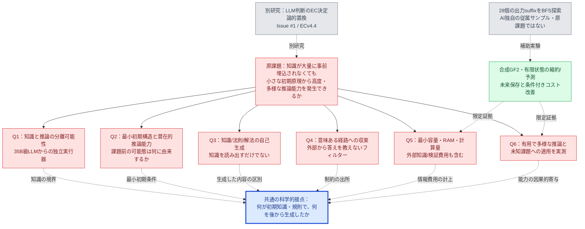
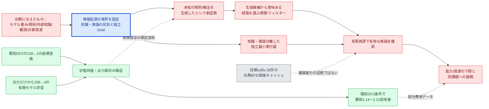

# 原課題を復元した課題図・技術図（2026-11-07）

[発言・記録の照合と不確実性](ROOT_OBJECTIVE_PROVENANCE_REAUDIT_2026-11-07.md)を根拠に更新した**当面の研究ナビゲーション図**。これはユーザーが最終承認した逐語的な原文と同一ではなく、取得可能なユーザー発言からの再構成。原課題をBFSや状態縮約にすり替えない。

**色**：赤＝未解決、橙＝部分的実装/仮説、緑＝実証済みだが限定、灰＝別研究/補助、青＝現在の最小接点（正しさを主張しない）。

## 1. 課題図：ユーザーの問いと研究・手段を分ける

**根拠上の注意**：BRは6問いを**厳密な論理依存で全てブロックする単一技術**という主張ではない。既にある情報か新たな能力生成かを混同しないための共有監査条件である。関係数を数えて「自動的に最も科学的重要」とするのは禁止。

## 2. 技術図：技術が原課題に対して実際にできること

## 3. 直近の実験を正しく評価し直す

| 証拠 | 正しく言えること | 言ってはいけないこと |
|---|---|---|
| P4/GF2 n128→2 | **事前に与えられた**遷移系の将来観測を保存する座標は導出できる | 未知の知識や推論原理を自発生成した |
| k0 L* raw256→4 | 出力インターフェースだけから小さい将来予測機械を学習できる | 知識から独立な汎用推論が成立した |
| P3 / raw snapshot 接続 | 強い情報アクセス条件なら有限rawの対応や既知XOR候補を使える | 任意の非線形未知規則の発見 |
| C6既知GF2 2.14〜2.21倍 | 同じ合成遷移・長い反復で初期/証明費込みで有利 | 推論能力そのものが2倍改善した |
| 28個のsuffix/BFS＋直接キャッシュ | 正答一致20可／8不可、直接キャッシュ最大126問 vs L*学習322問 | 「最小生成原理による飛躍的推論能力」の証拠 |

## 4. グラフに沿う次の本線

**P0は知識起源と生成新規性の区別（P）の可否・前提の固定**。これは**原課題を『評価器を作る課題』へ変更する意味ではない**。最短で次の問いを片付けるために使う：

> 元の規則・外部情報・答えを最初から内部に与えず、どんな最小初期規則が、未与の法則や解法を有限資源で**導出できる**か。その条件と不可避な情報量はどの程度か。

この問いに既存論文・既存PoCが答えている場合は**再利用**。答えていない場合だけ、知識量・初期容量・推論中の観測・検証器の情報流入を区別した反証可能な最小実験を選ぶ。最初のPoCは28個の2進ゴールタスクではない。

**STOP/ゲート**：原会話の全文未回収部分は情報欠落として明記。別研究のIssue #1をこの原課題の完了条件に混ぜない。ECv4.4実装は別枝。以前のgraph-centralityの数値を流用しない。相関的な改善・短い状態表・BFSのPASSを飛躍的推論と呼ばない。
