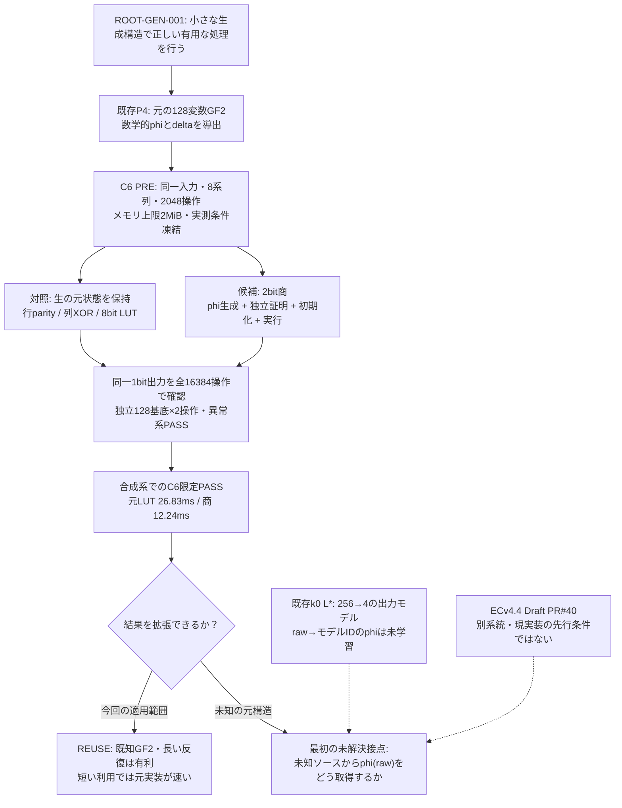
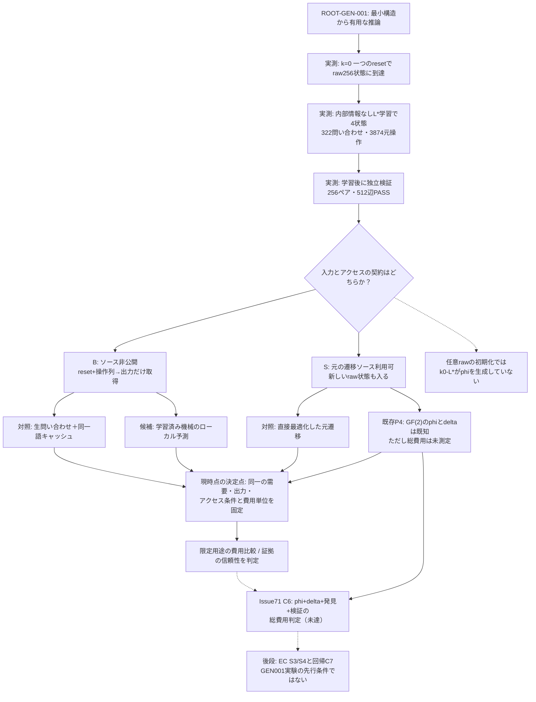
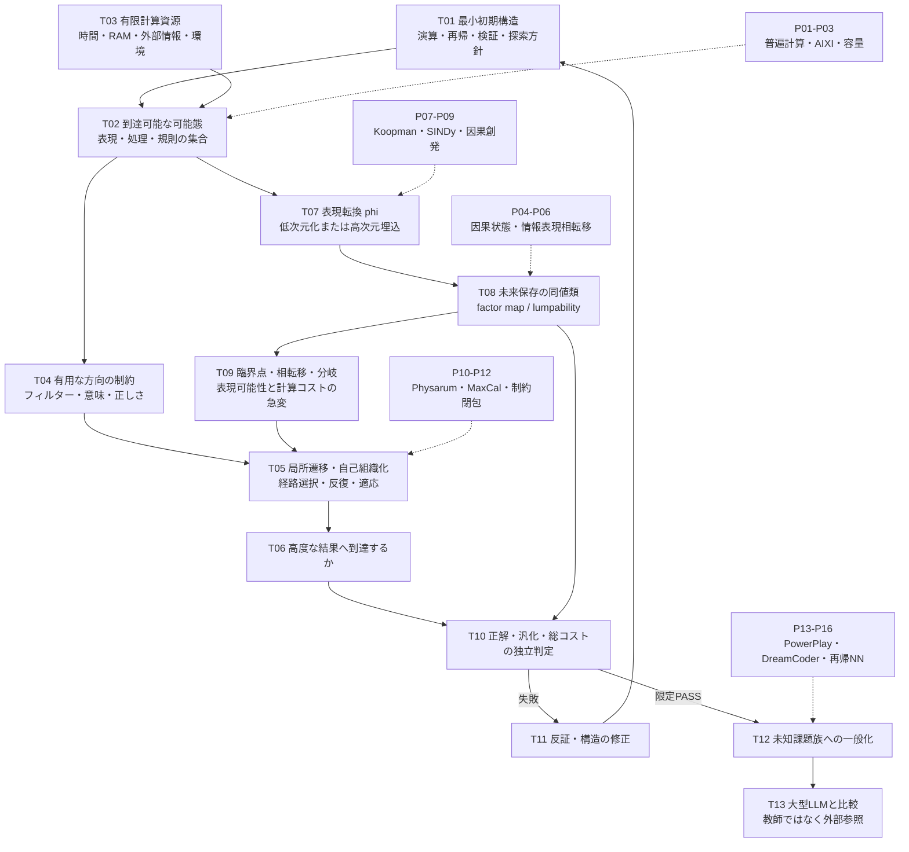

# 技術的課題・数学的接続（Mermaid）

「次元／表現の転換で何が急に単純になるのか」と「局所的な構造だけで複雑な推論に収束するのか」を、混同せず接続する。

## CURRENT_EXECUTION_GRAPH_2026_11_07

**2026-11-07 現在の依存関係・本線判断。以下A–Eは歴史的・概念的な図。**

### C6実測後の最新クリティカルパス（実測後の判断を正とする）

[実行前の凍結PRE](C6_FAIR_COST_PRE_2026-11-07.json) / [再現コード](poc/c6_fair_cost.py) / [7試行×全方式の実測](poc/C6_FAIR_COST_OBSERVED_2026-11-07.json) / [受入条件・異常系・限界](poc/C6_FAIR_COST_FINDINGS_2026-11-07.md)。

**結果**：CPythonの合成GF(2)環境では、直接最適化した元8bit LUT方式（入力rawは128bit）の総費用26.832msに対し、ランク2の商は12.240ms（生成＋独立証明＋初期化＋8×2048操作込み）。他の2回の独立実行も約2.14～2.21倍。固定2MiB上限内で同等1bit出力を全16,384操作照合した。一方8×1・8×16操作では直接元行parityが商より速い。原課題のC6は**既知GF2における限定証拠を獲得**したが、未知機構の発見や一般的なCPU最適化のPASSとはならない。

**この図を最新とする。** 以下の「依存図（実測状態と代替手段）」とその後の測定前の文面は2026-11-07の**事前監査時点の履歴**として残す。新たなPoCを自動開始しない。

**単一の判断**: いま C6 を測るには、**どの実行契約の、どの費用を比較するのか**を先に固定しなければならない。直近の256→4ブラックボックス学習は歴史からの観測列に対する「予測器」を生成したが、任意raw状態の `phi(raw)` を発見したわけではない。Issue #71のC6が要求する `phi,delta,checker,discovery` 総費用と、履歴問い合わせ型予測器の費用は分けて評価する。

### 履歴：C6実測前の依存図（現行判断は上記）

**図の読み方**: C6への実線は既存の`phi`を持つP4線形系の路線。ブラックボックス予測器の費用評価はC6に寄与し得るが、同じ型の`phi`総費用の証明ではないため点線。EC系は後段の別ゲート。図から新しいPoCを自動起動しない。

### 比較対象・費用の欠落（計算できる部分だけ再利用）

| 比較経路 | 入力と同一のタスク | 公正な無学習の対照 | 現存する数値 | 主な欠落 |
|---|---|---|---|---|
| B: ブラックボックス予測 | 固定reset・操作列から最後の1bit観測を得る | 元系へ直接問い合わせ＋同一操作列のキャッシュ。既知の出力だけを再利用 | 学習に322個のユニークな問い合わせ・元遷移3,874回。学習後のモデルは局所予測可能 | 実際の問い合わせ単価／遅延、予測需要のユニーク数・系列長、独立の実システム検証 |
| S: ソース利用／既知線形P4 | 同一入力の出力を元システムと`phi,delta`の両方式で生成 | 直接最適化した元の計算。必要なら最も単純なキャッシュ | P4の2次元GF(2)商は条件付き数学的に証明、元系の内部規則は既知 | `phi`計算・検証・実行・生成コストを同じ単位で測っていない |
| 任意のraw状態からk0-L*を利用 | 生状態rawの現在出力・未来出力を得る | raw側の直接計算／参照実装 | k0-L*では履歴から未来を予測可能 | **raw→学習state IDの写像がない**ため、現成果でこの用途は未成立 |

**源泉側の問い合わせ回数だけの仮定的計算**：もし学習後の要求がすべて**既出と異なる操作列**で、対照が1列につき1回元系へ問い合わせ、学習器は正しいと信頼できるなら、無学習の元系問い合わせQ回に対して、学習時の実績は322回。よってQ=323回以降に*問い合わせ回数*だけでは減少し、例としてQ=1,000なら678回減る。**実際の総費用改善を意味しない**。既出語にはキャッシュが効く。検証用の512辺は**ソースを知る検証側のチェック**で、ブラックボックス運用者が実行できる保証ではなく、検証全費用でもない。両方式のローカル演算、学習器自体の負荷、問い合わせ単価、実運用の需要は未測定。

### 今回実施したP4の最小静的演算監査（実時間の速度試験ではない）

既存[PoC4の`eval_rows`と`quotient`](poc/poc4_repro.py)を読み、**n=128、許可操作0/1、連続する同一状態ストリーム**で1回の更新に必要な演算を分類した。

| 演算部分 | 元の実装 | 2座標商の実装 | 証拠の種類 |
|---|---:|---:|---|
| 元の1回の状態遷移 | 128行それぞれに`dot`/parityを1回 | — | コード構造から導出、未計時 |
| 商の1回の状態遷移 | — | 2行のparity演算 | コード構造から導出、未計時 |
| 元rawの初期状態を商へ写す | 不要 | 初回のみ2行のparity | 既知`phi`の利用費 |
| 出力取り出し | 1行のparity | 1行のparity | 同一1bit出力契約 |
| 商の生成と数学的検証 | 不要 | 非ゼロ、未計測 | **Issue#71 C6の未充足部分** |

**単純に128/2=64とするのはparity呼出回数の構造上の比だけ**であって、64倍の速度向上を実測したわけではない。`bit_count`のビット幅、元行列の疎密、最適化、キャッシュ、基底の構築、検証費用などを含まない。元のコードを知る側であれば、元系を直接最適化して同じ部分計算を利用する可能性があるため、**高コストなraw実装だけを対照にすることは禁止**。

**次に残った本当の最初の接点**：固定ソースと同じ1bit出力の連続操作を基準に、元系の直接最適化対照（状態表を作る／行列を前計算する／同一出力を再利用する等）を比較候補として固定し、どの候補が実際に実行できるか確認してから、`phi`構築＋検証を含む費用測定を事前登録する。これ以前の速度優位宣言は保留。

### 2026-11-07 元の処理を投影せずに高速化する対照の検算を実施

[実行済みの元raw直接実行の2案](poc/c6_direct_no_projection_baselines.mjs) / [検算結果](poc/C6_DIRECT_BASELINE_PRECHECK_2026-11-07.json)。128bitの元状態`x`を保持し、`phi`による座標縮約を**一切行わない**2方式を用意した。

- 列XOR方式：`M_a`の各列を前処理で格納し、入力rawの立ったビットに該当する列をXORする。元rawを保持。2操作・128bit列固定長で表データ約4KiB（実装オブジェクトのオーバーヘッド除外）。
- 8bitブロックLUT：操作別に16ブロック×256パターンを前計算し、各操作を16回のテーブル参照とXORで実行。2操作・128bitマスク固定長で表データ約128KiB（同上）。
- 各操作についてゼロ＋128基底入力を全検算（計258）、さらに乱数入力を計1,024ケース検算し、元の行parity方式と一致。GF(2)の線形性により基底一致は任意raw入力の遷移同値性を示す。ただし出力の読出しは両方式で同一の元parity関数。

**これで比較可能な最適化済み・非投影の選択肢は確定した。** ただし生成費用、実行速度、メモリ実測、`phi/delta`学習・証明込みの収支は未計測。どちらが最も速いか未判定。次は**入力分布・利用回数・前処理の償却条件・許容RAMの4点だけ**を凍結し、その後初めてC6費用を測定する。高コストな素の行parity方式のみを対照にしない。

### 次の最小作業と明示的な停止条件

1. **今回実施（再実験不要）**：Issue#71 C6の対象は`phi`を含む既知P4路線であることと、直近L*路線の比較範囲を固定し、旧Mermaidの「未知目標の自動計画」への直進を**歴史的な提案**として降格。
2. **次に必要な単一判断**：「元系に直接アクセスする処理か、出力問い合わせだけなのか」「同じ需要は何か」「C6をどの路線で閉じるか」を、既存利用想定と一緒に固定する。**実利用の需要・アクセス契約を固定しないまま総費用PoCは実行しない**。
3. 入力・対照が固定された後だけ、既存証拠を再利用した狭いコスト測定を事前登録。正しさは独立検証、資源は実測。PASS/FAIL/UNKNOWNを分ける。
4. 未発見の`phi`、未知課題への一般推論、実EC S3/S4、外部義務目録は現時点のC6比較設計の先行条件ではない。必要な用途が実際に指定されたときにだけ復帰。

### 原課題への寄与区分

- **証明済み（限定）**：既知線形GF(2)系の座標商、合成8bit k0の源泉を隠した学習済み4状態機械と、元の到達256状態の将来観測一致。
- **未証明**：ブラックボックスL*による任意raw状態投影、総コスト削減、より広い未知課題の推論、一般的なNNの生成原理。
- **別の作業経路**：ECv4.4への証拠候補受付とDraft PR #40の全既存SUITE／S3/S4統合。原理発見に対する直前の必須条件ではない。

## A. 技術依存グラフ

## B. 似て見えて異なる4種類の単純化

| 現象 | 厳密／実用上の論点 | 何が減るか | 注意 |
|---|---|---|---|
| 同値類（causal states, bisimulation） | 未来の予測・観測が同一なら区別不要 | 必要な状態数 | 対象出力、入力、時間範囲を限定する |
| 粗視化（coarse-graining） | 巨視的な変数が有用な因果情報を保つ | 説明上の自由度 | 単なる情報廃棄を能力向上と誤認しない |
| 表現の持ち上げ（Koopman） | 複雑な非線形遷移を別空間では線形に表す | 遷移規則の複雑さ | 次元が増える場合、phiの費用が増える |
| 動的収束（Physarum・attractor） | 局所規則を反復すると経路・解が安定化する | 明示的な全探索・制御の必要性 | 収束時間、局所極小、初期条件を測る |

## C. 数学的な最小条件（本研究の定義案・既知定理と区別）

1. 微視的状態 x, 入力 u, 遷移 T、抽象状態 z = phi(x)、抽象遷移 delta を考える。
2. 未来保存条件（厳密）: **phi(T(x,u)) = delta(phi(x),u)**。さらに必要な出力 y に対し、**O(x) = h(phi(x))** を満たす。
3. 同じ抽象状態に落ちる2つの元状態が異なる未来の出力を持つなら、この投影は不適格。これは [既存研究内の先行記述](https://github.com/mokumaisancho/neural-algorithmic-reducibility/blob/main/PHYSICS_AND_EPISTEMOLOGY.md) と一致する。
4. 有限資源 B、目標課題族 U の下で、初期機構・変換・経路更新規則・検証器・初期状態の**総記述長**と、実測計算量を扱う。ルールだけを短くして変換や環境にコストを移したら成功とはしない。
5. 臨界点の候補は、変換の制御パラメータ a の変化に対し、必要抽象状態数・推論成功率・計算費用が不連続もしくは鋭く変化する点と定義する。ただし真の相転移と有限標本・許容誤差による見かけの急変を区別する。
6. 推論可能態を「潜在的に出力可能な全列挙数」と同一視しない。有限資源で**正しい・意味ある**結果へ到達する範囲、深度、確率を測定する。

## D. 先行研究と利用目的の対応
- **普遍計算・必要な初期構造**: [P01 Rule 110](PAPERS_AND_CLAIMS.md#p01), [P02 AIXI](PAPERS_AND_CLAIMS.md#p02), [P03 アルゴリズム情報](PAPERS_AND_CLAIMS.md#p03)。
- **最小未来保存状態と臨界点**: [P04 Computational Mechanics](PAPERS_AND_CLAIMS.md#p04), [P05 IB相転移](PAPERS_AND_CLAIMS.md#p05), [P06 State Aggregation](PAPERS_AND_CLAIMS.md#p06)。
- **次元転換と自然収束**: [P07 Koopman](PAPERS_AND_CLAIMS.md#p07), [P08 SINDy](PAPERS_AND_CLAIMS.md#p08), [P09 Causal Emergence](PAPERS_AND_CLAIMS.md#p09), [P10 Physarum](PAPERS_AND_CLAIMS.md#p10), [P11 MaxCal](PAPERS_AND_CLAIMS.md#p11), [P12 Closure of Constraints](PAPERS_AND_CLAIMS.md#p12)。
- **自己発達する小型推論器**: [P13 PowerPlay](PAPERS_AND_CLAIMS.md#p13), [P14 DreamCoder](PAPERS_AND_CLAIMS.md#p14), [P15 Recurrent Algorithms](PAPERS_AND_CLAIMS.md#p15), [P16 Tiny Recursive Models](PAPERS_AND_CLAIMS.md#p16)。
- **意味と対象限定**: [P17 Semantic Information](PAPERS_AND_CLAIMS.md#p17), [P18 Generalization Difficulty](PAPERS_AND_CLAIMS.md#p18)。

## E. 直接の技術ブロッカー
**B0 — 表現変換が「解の発見に必要な構造」を保つだけでなく、変換／探索／検証を含む総費用で有利になる条件の特定。**

B0が成立する前にニューラルネットワークを増築したり巨大LLMを圧縮したりする必要はない。単純化を証明できる有限状態系を対照にするのが最小PoC候補。ただし、この記録では試験未実行（NOT_RUN）。

参照: [議論変遷](ISSUE_FLOW.md) / [論文台帳](PAPERS_AND_CLAIMS.md)。
