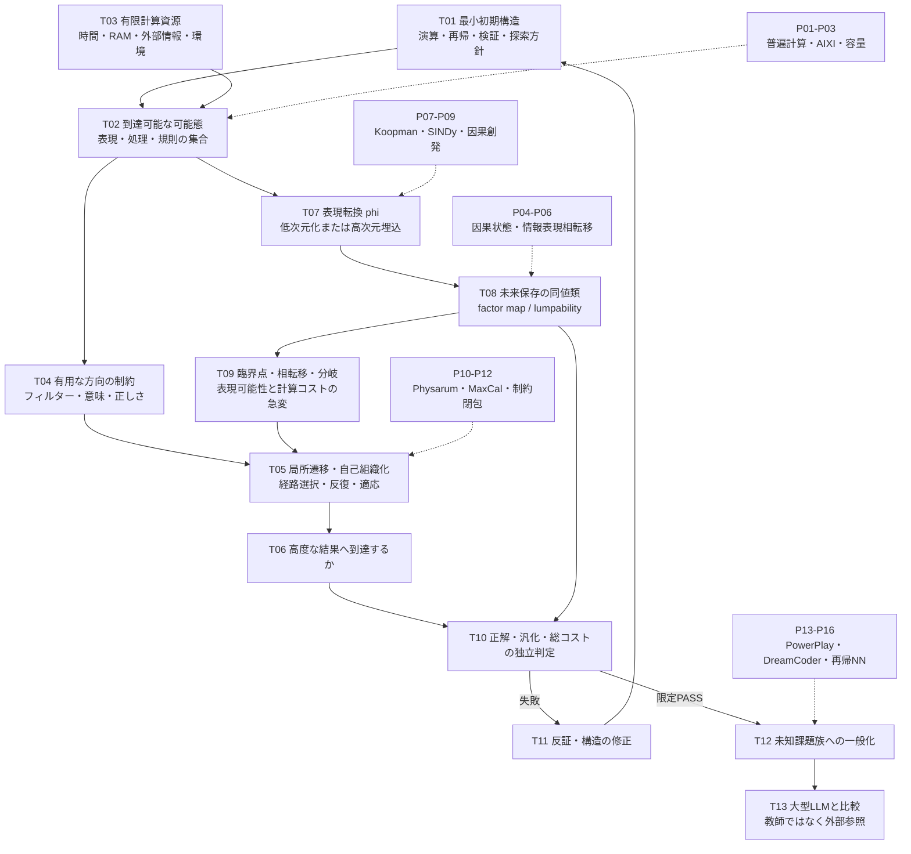

# 技術的課題・数学的接続（Mermaid）

「次元／表現の転換で何が急に単純になるのか」と「局所的な構造だけで複雑な推論に収束するのか」を、混同せず接続する。

## A. 技術依存グラフ

## B. 似て見えて異なる4種類の単純化

| 現象 | 厳密／実用上の論点 | 何が減るか | 注意 |
|---|---|---|---|
| 同値類（causal states, bisimulation） | 未来の予測・観測が同一なら区別不要 | 必要な状態数 | 対象出力、入力、時間範囲を限定する |
| 粗視化（coarse-graining） | 巨視的な変数が有用な因果情報を保つ | 説明上の自由度 | 単なる情報廃棄を能力向上と誤認しない |
| 表現の持ち上げ（Koopman） | 複雑な非線形遷移を別空間では線形に表す | 遷移規則の複雑さ | 次元が増える場合、phiの費用が増える |
| 動的収束（Physarum・attractor） | 局所規則を反復すると経路・解が安定化する | 明示的な全探索・制御の必要性 | 収束時間、局所極小、初期条件を測る |

## C. 数学的な最小条件（本研究の定義案・既知定理と区別）

1. 微視的状態 x, 入力 u, 遷移 T、抽象状態 z = phi(x)、抽象遷移 delta を考える。
2. 未来保存条件（厳密）: **phi(T(x,u)) = delta(phi(x),u)**。さらに必要な出力 y に対し、**O(x) = h(phi(x))** を満たす。
3. 同じ抽象状態に落ちる2つの元状態が異なる未来の出力を持つなら、この投影は不適格。これは [既存研究内の先行記述](https://github.com/mokumaisancho/neural-algorithmic-reducibility/blob/main/PHYSICS_AND_EPISTEMOLOGY.md) と一致する。
4. 有限資源 B、目標課題族 U の下で、初期機構・変換・経路更新規則・検証器・初期状態の**総記述長**と、実測計算量を扱う。ルールだけを短くして変換や環境にコストを移したら成功とはしない。
5. 臨界点の候補は、変換の制御パラメータ a の変化に対し、必要抽象状態数・推論成功率・計算費用が不連続もしくは鋭く変化する点と定義する。ただし真の相転移と有限標本・許容誤差による見かけの急変を区別する。
6. 推論可能態を「潜在的に出力可能な全列挙数」と同一視しない。有限資源で**正しい・意味ある**結果へ到達する範囲、深度、確率を測定する。

## D. 先行研究と利用目的の対応
- **普遍計算・必要な初期構造**: [P01 Rule 110](PAPERS_AND_CLAIMS.md#p01), [P02 AIXI](PAPERS_AND_CLAIMS.md#p02), [P03 アルゴリズム情報](PAPERS_AND_CLAIMS.md#p03)。
- **最小未来保存状態と臨界点**: [P04 Computational Mechanics](PAPERS_AND_CLAIMS.md#p04), [P05 IB相転移](PAPERS_AND_CLAIMS.md#p05), [P06 State Aggregation](PAPERS_AND_CLAIMS.md#p06)。
- **次元転換と自然収束**: [P07 Koopman](PAPERS_AND_CLAIMS.md#p07), [P08 SINDy](PAPERS_AND_CLAIMS.md#p08), [P09 Causal Emergence](PAPERS_AND_CLAIMS.md#p09), [P10 Physarum](PAPERS_AND_CLAIMS.md#p10), [P11 MaxCal](PAPERS_AND_CLAIMS.md#p11), [P12 Closure of Constraints](PAPERS_AND_CLAIMS.md#p12)。
- **自己発達する小型推論器**: [P13 PowerPlay](PAPERS_AND_CLAIMS.md#p13), [P14 DreamCoder](PAPERS_AND_CLAIMS.md#p14), [P15 Recurrent Algorithms](PAPERS_AND_CLAIMS.md#p15), [P16 Tiny Recursive Models](PAPERS_AND_CLAIMS.md#p16)。
- **意味と対象限定**: [P17 Semantic Information](PAPERS_AND_CLAIMS.md#p17), [P18 Generalization Difficulty](PAPERS_AND_CLAIMS.md#p18)。

## E. 直接の技術ブロッカー
**B0 — 表現変換が「解の発見に必要な構造」を保つだけでなく、変換／探索／検証を含む総費用で有利になる条件の特定。**

B0が成立する前にニューラルネットワークを増築したり巨大LLMを圧縮したりする必要はない。単純化を証明できる有限状態系を対照にするのが最小PoC候補。ただし、この記録では試験未実行（NOT_RUN）。

参照: [議論変遷](ISSUE_FLOW.md) / [論文台帳](PAPERS_AND_CLAIMS.md)。
