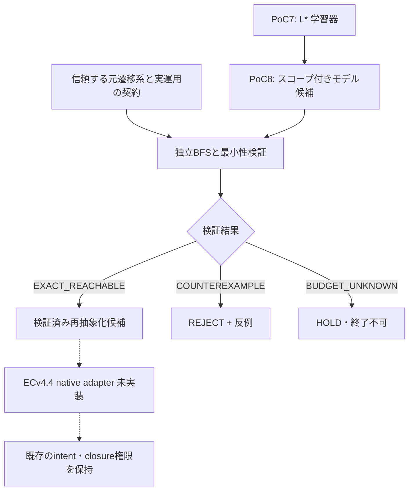

# PoC8 — 学習モデルの適用範囲と独立検証の証拠ゲート

日付：2026-11-06。ROOT-GEN-001／Issue #71。
ステータス：**SCOPED_PASS（11試験・11アサーション）**。ECv4.4 native統合と本番適用はNOT_RUN。

[実行コード](poc8_scope_gate.mjs) ／ [全実測結果](POC8_EXECUTION_2026-11-06.json) ／ [PoC7](POC7_FINDINGS.md)。

## 解こうとした課題
PoC7の学習器は指定した入力・出力の有限状態機械を再構成したが、学習器の停止・限られたサンプルの一致は「全経路が正しい」の証明ではない。今回のB0は、学習結果をECv4.4へ提案する前に、**初期状態、許可された操作、観測対象、元システムの一致を保証し、範囲外や不確かな結果をPASSへ昇格させないこと**。

## PoC8の実装
- 型付き候補 BEHAVIORAL_ABSTRACTION_CANDIDATE_V1：source_id、reset、actions、output_id、遷移表と初期状態。
- 正しさ：信頼できる元システムと候補モデルの積状態空間をBFSで調べ、指定resetからの全到達可能経路の出力が一致することを確認。反例は入力列として返す。
- 最小性：元システムの到達可能状態を独立に分割精緻化。正確だが冗長な候補も排除。
- 判定：EXACT_REACHABLE→PROPOSE_VERIFIED_REABSTRACT、COUNTEREXAMPLE→REJECT、BUDGET_UNKNOWN→HOLD。
- 候補の自己申告のPASSや前回の証拠を信用せず、指定条件について検証器が再計算。
- あくまで**外部提案ゲート**。ECv4.4のactual S3/S4 native bindingもclosure権限も変更していない。

## 実測
| 試験 | 実測結果 |
|---|---|
| 8bit有限系・reset=warm・actions=[0,1] | 4状態モデルを再学習。27 unique queries。厳密一致かつ最小 |
| reset変更 | REJECT |
| 操作集合の拡大 | REJECT |
| output_id変更 | REJECT |
| source_id偽装 | REJECT |
| 誤った出力を改竄し自己申告PASS | REJECT、反例=空列 |
| 誤った遷移式 | REJECT、反例=[0] |
| 検証上限=1状態 | HOLD（誤PASS防止） |
| 1状態の早期終了・不完全モデル | REJECT、反例=[0] |
| 正しいが到達不能な冗長状態を含むモデル | REJECT（非最小） |
| 128bitの非線形座標変換合成系 | 4状態モデルを再学習。14 unique queries。厳密一致かつ最小 |

コードはNode.js v22.16.0で直接実行。ローカルソースとGitHub上のGit blob SHAの一致を確認：
77b951f1eacbe27c770b6d1f8d9be60e1cca41e0。

## 科学的な限界
- 厳密な証明は**指定resetから到達できる状態と指定操作のみ**。元の128bit空間すべての状態を網羅したものではない。
- 学習器はL*に基づく実装だが、学習時の等価性オラクルは元システムを参照して反例だけを返す。PoC7の確率的なブラックボックステストと同じ条件ではなく、完全な無教師推論器の実証ではない。
- 128bit非線形系は以前のPython実験と同系統の合成系のJavaScript版であり、元のPython L*実装を直接実行したものではない。
- source_idは論理識別子であり、実装の暗号学的な真正性は保証していない。現在は信頼できる元システムの同時照合を前提とする。
- native ECv4.4・SUITE・継続運用の結合確認、実測の総計算費用はNOT_RUN。

## 次の単一ブロッカー
**source-version-boundな証拠を、ECv4.4 native S3/S4の候補／終了判断に安全に接続する。**

受入条件：①実際の遷移実装のsource SHA固定、②reset/actions/outputと元intentの不変条件を一致照合、③証明がUNKNOWNならHOLD、反例ありならREJECT、④native終了判定をバイパスしない、⑤固定ECコミットで正常系・変異系・回帰試験、⑥学習・証明・運用の総費用を測定。

これらは未達。PoC8のPASSをECv4.4のAC PASSへ転用しない。

## 技術依存（Mermaid）

