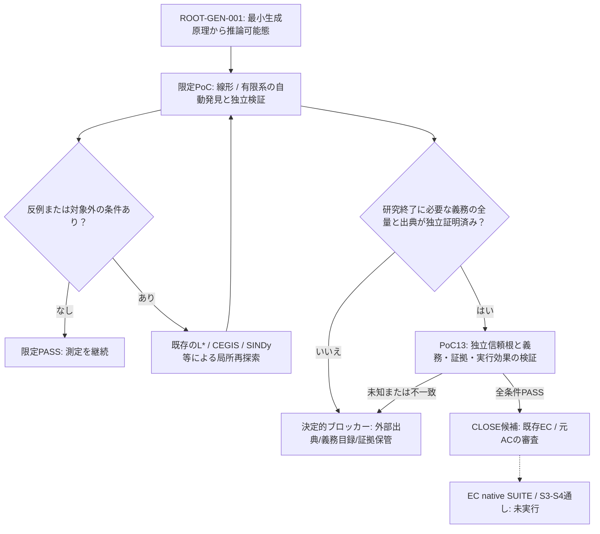

# GEN001 PoC13 — 限定解決の許容条件と、決定的なブロッカーの実測

2026-11-06 / [原課題 ROOT-GEN-001](../README.md) / [研究 Issue #71](https://github.com/mokumaisancho/LLM-EC-Layerwise-Ablation/issues/71)

[再現コード（実行済み・Git blob一致）](poc13_repro.py) ／ [64ケース・変異テストの結果](POC13_OBSERVED.json) ／ [直前のS4 64ケース](../holdout_s4_2026-11-06/REPORT.md)

## 結論（決定点単一）

**最小の非線形生成原理を普遍的に発見できないことは、現在の「有限・決定論的・到達可能な系を検証する」PoCのブロッカーではない。**

**決定的なブロッカーは、研究をCLOSEするために必要な義務・規範・証拠の全量と真正性を、検証対象とは独立した出典で確定できていないこと。** 証拠のない世界でそれを「発見済み」と推定することは情報論的にできない。これは新しいNNを入れるだけでは解消しない。

既存先行設計 [ISSUE1_W4B_W4C_TYPED_EVIDENCE_CONTRACT_V1](https://github.com/mokumaisancho/LLM-EC-Layerwise-Ablation/blob/main/docs/ISSUE1_W4B_W4C_TYPED_EVIDENCE_CONTRACT_V1.json) と [W4B/W4C独立証明AC](https://github.com/mokumaisancho/LLM-EC-Layerwise-Ablation/blob/main/docs/ISSUE1_W4B_W4C_INDEPENDENT_PROOF_AC_V1.md) に「義務ゼロには明示的全量証明が必要」「外部資料と独立根拠がなければCLOSE不可」と記録済み。今回、新しい独自証明理論を導入したのではなく、この境界を観測モデルの実験へ接続した。

## PoC13：既存S4誤CLOSEの遮断を検証

前回PoC12の64件と同型の**新規合成試験**を、候補の自己申告ではなく、ホスト側で固定した「義務の登録元」「義務IDの全量目録」「個別証拠」「実行結果の確認」に照らして実行。ホストが保持する権威付きバンドルのハッシュは**候補とは別の入力**として与える。実際の外部独立キュレーターの証拠ではなく、今回の試験用ダミー信頼根に限る。

| 指標 | 直前の凍結済みS4ルール | PoC13の証拠ゲート |
|---|---:|---:|
| 合成ケース数 | 64 | 64 |
| 正しく判定 | 48 | **64** |
| 誤ってCLOSE | **16** | **0** |
| 正しくCLOSEできる件数 | 24 | **24** |

追加変異試験**11条件**が期待どおり拒否／保留：独立権威なし、偽の空目録、古いソース、改変ソース、他出典の証拠、未知の実行効果、未証明義務、スコープ不一致、候補による自己証明、ホスト固定ハッシュと異なる偽権威、ホスト固定根拠そのものがない場合。

技術上の追加発見：**権威を示す `verified=true` だけでは不十分**。候補が「検証済みの権威一式」まで自由に投入できれば架空の義務目録でCLOSE可能。ホストが独立に固定したルートハッシュとの照合を要求し、ルートがない場合は必ず BLOCKED とする。ルートの正当性は今後独立したソース管理者が保証する必要があり、このPoCだけで解決したわけではない。

再実行：Python標準機能のみ。実際に実行したコードの Git blob SHA `f439a54bbbbf221a30e33a79ed92954275fbbc26` とGitHub格納内容はバイト一致。実行ファイルSHA-256 `7eb95c6d2fddd1c2d7f23def3cb415ee3947594359cc0139255b0becdefb123d`。

## どの限定が許容でき、どこから拡張が必要か

| 条件 | 処理 | 自動的な次アクション |
|---|---|---|
| 実験対象が有限かつスコープ固定、独立同値性証明PASS、原課題のACに適合 | **限定PASSを保持** | 大規模な汎用生成器の自作不要。次の測定へ |
| 未知の操作・初期状態、モデルに反例、予測能力の低下 | **既存のPASSを失効** | 証拠付き反例を登録→AALpy/L*、CEGIS等の既存探索器で再抽象化を再試行 |
| 既存の有限状態学習で扱えない非線形連続系 | **研究対象を切替** | SINDy Autoencoders等の既存論文実装で限定PoC→独立検証 |
| 義務の全量目録・出典・実行結果が未確定 | **BLOCKED / CONTINUE** | 証拠ID、文書版、未確認理由を固定。外部資料取得・独立根拠確定が必要 |
| ECv4.4 native実行経路のフルSUITE未実施 | **マージ／本番評価不可** | 既存回帰、S3/S4、V3最終終了の真正な実行が必要 |
| 最小状態数は減るが総費用は増える | **性能AC不合格** | 当該縮約を採用しない。学習／証明／運用費の実測を優先 |

この条件分岐により、普遍的な最小法則発見器の完成を**今すぐすべての実験の前提とはしない**。一方で、それを必要とする反例が出た場合は、別Issueの無制限開発ではなく、反例と既存の先行研究によって局所的に解決する。

## 決定的ブロッカーの根拠と範囲

1. **情報の識別不能性（真正）**：観測項目が同じなのに正解が異なる16組がPoC12で存在。情報入力を追加しない限り一般的な判定関数では区別できない。
2. **権威・出典の欠落（真正）**：外部の規範文書、網羅的な義務一覧と証拠、実行結果を独立に確定した根拠が未取得。今回のホスト固定ハッシュは**技術的な整合性**であり、真実性・完全性の外部証明ではない。
3. **試験環境の不足（統合時にのみ阻害）**：[ECv4.4 Draft PR #40](https://github.com/mokumaisancho/GPT-EC-Closure-Engine/pull/40)の変更後全SUITE・実S3/S4〜V3通しはNOT_RUN。これを現在の合成研究PoCの終了ゲートに混ぜない。
4. **非線形汎用推論生成（将来の原理研究）**：既知の線形・有限系での成功を未知のすべての系へ一般化することは不可能。既存手法の適用範囲外に出たときだけ、必要な実験を起動する。

## 重要な非主張

- **64/64は信頼根まで含めて合成された条件付きの正しさ**であり、実世界の独立したS4 goldでの正答率ではない。
- 11件の変異テストは、未観測の全故障を防ぐ証明ではない。
- 新たな発見規則の性能、真の普遍性、大規模LLM並みの推論能力は未検証。
- このPoC13はECv4.4本体へ未マージ・未配線。既存W4B/W4C仕様・元の18ACは変更していない。

## 依存関係

**次の1アクションは外部資料に根拠づけた「義務一覧が全量である」ことの証明を、既存W4B/W4C証拠契約に沿って取得・登録すること。** これが存在しない限り、EC本番のCLOSE権限は与えない。取得に成功した段階で、必要最小のnative adapterと回帰試験を実行する。
