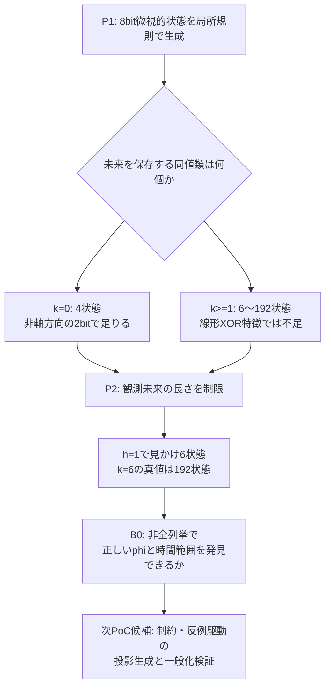

# MGR-P1/P2 実験報告 — 2026-11-05

**状態: 実行済み（サンドボックスの合成有限状態PoC、7条件、全状態検証）。既存ECv4.4のACやNN研究の完了を意味しない。**
対象原課題: [ROOT-GEN-001](../README.md)、[課題の変遷](../ISSUE_FLOW.md)、[技術依存](../TECHNICAL_DEPENDENCIES.md)。

## 0. 最初に結論

- **P1で解決した限定的な問い**: 表現を変えると、もとの軸に沿った投影では8ビット必要な256状態の系が、未来予測には**4状態（2ビット）**で十分になる構成例を全状態で確認した。
- **P1の反例**: 出力に効く隠れ状態が1段入るだけで、必要状態が**6**になり、線形XOR特徴の組合せだけでは正確な最小状態を表せない構成例を得た。
- **P2で解決した限定的な問い**: 短い将来しか評価しないと、必要状態を過小評価する。最長6ステップ影響する系では、1ステップ観測で6状態、全未来を保存するには192状態。
- **次の最重要未解決課題**: 状態を全部列挙せず、局所的な生成規則や限られた観測から、**必要な未来と正しさを維持する表現変換 `phi` を自動発見**できるか。発見器・変換器・検証器も含めて総コスト改善があるか。

## 1. 実行したPoCの範囲

- 合成モデル: 8ビットの状態（256通り）＋2種類の入力、1ビット出力。大型LLM、事前学習、モデル圧縮、蒸留は**使用しない**。
- 内部状態: `phase`（2ビット）＋`noise`（6ビット）。`encode` で両方のphaseビットをnoiseパリティとXORして座標を混ぜる。
- `k=0..6`: 将来のphaseに影響するnoise情報の深さを変更。隠れ状態には局所的な遷移、phaseには入出力応答を定義。
- 方法: Moore型の有限状態分割精緻化 → 状態同値の全状態・全入力検証 → raw座標の部分集合256候補を検証 → 線形XOR不変量を評価 → 故意に非同値状態を統合する異常検査。
- PoC2: 将来の入力系列の長さを0〜8ステップに制限して、表面的に同一視されたが本当は区別すべき状態ペアの数を計測。差が出る実際の入力列を生成。
- 再現: Python標準ライブラリのみ。実験コード [run_poc.py](run_poc.py)、[poc_horizon.py](poc_horizon.py)。記録 [results.json](results.json)、[horizon_results.json](horizon_results.json)。

## 2. P1結果（実行値）

| k | raw状態 | 真の最小因果状態 | 最小符号ビット | 軸に沿う必要ビット | XOR特徴だけで完全か | 明示的状態遷移表の比較例* |
|---:|---:|---:|---:|---:|---|---:|
| 0 | 256 | 4 | 2 | 8 | YES | 4352→20 bit |
| 1 | 256 | 6 | 3 | 8 | NO | 4352→30 bit |
| 2 | 256 | 12 | 4 | 8 | NO | 4352→84 bit |
| 3 | 256 | 24 | 5 | 8 | NO | 4352→216 bit |
| 4 | 256 | 48 | 6 | 8 | NO | 4352→528 bit |
| 5 | 256 | 96 | 7 | 8 | NO | 4352→1248 bit |
| 6 | 256 | 192 | 8 | 8 | NO | 4352→2880 bit |

*明示的な`状態×入力→次状態`の表のみを同一形式で符号化した理論的比較。**コード全体のサイズ、phiの記述長、モデル学習費、速度向上ではない**。この合成系は最初から短い生成規則で記述でき、巨大な表は生成する必要がない。表比を「LLM圧縮効果」と見なしてはならない。

P1の`k=0`では非軸方向のXOR射影2つ（例 `0x03`, `0xfd`）が、最小因果状態4つを識別した。一方`k=1`では最小因果状態は6つだが、全ての線形XOR不変量を使っても識別できるのは4つ。これは**元の表現を少数の線形座標へ投影するだけでは必ずしも十分でない**、具体的な反例。

## 3. P2結果（実行値）

| k | 未来を完全に保存するために必要な観測深度 | h=1で見えてしまう状態数 | 真の状態数 | h=1の誤統合ペア数 |
|---:|---:|---:|---:|---:|
| 0 | 1 | 4 | 4 | 0 |
| 1 | 1 | 6 | 6 | 0 |
| 2 | 2 | 6 | 12 | 3072 |
| 3 | 3 | 6 | 24 | 4608 |
| 4 | 4 | 6 | 48 | 5376 |
| 5 | 5 | 6 | 96 | 5760 |
| 6 | 6 | 6 | 192 | 5952 |

誤統合ペア数は、長さ`h`まで同等と判定した二状態が、完全な未来では異なることを示す**状態ペアの数**。ランダム標本における誤検出率ではない。

**反例の実証**: `k=6`、内部符号化状態 `0` と `11` は1ステップ観測では区別できない。しかし、入力列 `[0,1]` を与えると最終出力がそれぞれ `[1,0]` に分かれ、1ステップ評価による早期PASSを反証する。

## 4. 合格した検査と限定事項

- 入力状態全256通り×2入力（計512一段遷移）について、抽象化後の出力および次状態同値類が一致することを7条件で確認。
- 数学的に、同値類が一段先の出力・遷移を保存する場合、その同値関係は入力系列の任意長に対して帰納的に未来を保存する。
- 誤った同値類統合を故意に投入し、7条件で全て不合格と判定（false PASS防止）。
- 最小状態の判定には全256状態と2入力を列挙する既存の有限状態最小化アルゴリズムを使用した。**これは自力で法則を発明した証拠ではない。**
- 小型NNの内部重みを解析したわけではない。物理的な相転移、非線形推論の汎化、実用LLM並みの正答性能、実測の総計算高速化は未確認。
- `k`を増やす実験は離散的な設計条件の変更。4→6状態への変化は、任意の推論器で普遍的な臨界点が存在する証拠ではない。

## 5. 課題をどう更新したか — MECE

| 論点 | PoC前 | PoC後の判定 | 今後の処置 |
|---|---|---|---|
| A. 次元／座標を変えると本質的な状態が減るか | 未確認 | **限定PASS**: 8bit→2bitで未来保存 | 既知手法として利用 |
| B. 線形投影だけで最小状態に到達できるか | 未確認 | **反例発見**: k1以上でNO | 非線形な等価類形成を検討 |
| C. 短い観測で「見かけの収束」を本物と誤認するか | 未確認 | **限定PASS**: 5952ペアの偽同値（k6、h1） | 時間方向の反例探索を設計 |
| D. 初期構造・局所法則を知らずにphiを自動発見できるか | 未実施 | **OPEN** | **最優先の次PoC** |
| E. 発見・射影・検証を含む総費用が原実装を下回るか | 未実施 | **OPEN** | Dと同一実験で測定 |
| F. 高度な汎用推論・自然な有機体的収束へ拡張できるか | 未実施 | **OPEN** | A〜Eの証拠が出てから判断 |

## 6. 既存研究・論文との接続
- [P04 Computational Mechanics](../PAPERS_AND_CLAIMS.md#p04): 未来予測を保存する最小因果状態。**P1の直接的な方法論。**
- [P06 Causal States / Information Bottlenecks](../PAPERS_AND_CLAIMS.md#p06): 何を同値と見なすか。**P1/P2の正しさ条件。**
- [P05 IBの相転移](../PAPERS_AND_CLAIMS.md#p05): 本PoCは本当の相転移を測っていない。**別問題として保留。**
- [P07 Koopman](../PAPERS_AND_CLAIMS.md#p07)、[P08 SINDy](../PAPERS_AND_CLAIMS.md#p08): **次の「非列挙でphiを発見」する候補手法**。本PoCでは適用していない。
- [P10 Physarum](../PAPERS_AND_CLAIMS.md#p10): 自然な経路形成のモデル。本PoCは経路の最適化実験ではなく、未来保存状態の検証。
- [既存ECv4.4／S1〜S4接続](../ECV4_4_4_TRACE.md): 研究の記録・証拠・判断ゲートとの重複箇所を接続。**既存ECのACをPASS変更しない**。

## 7. P1/P2時点の仮の決定点（P3実施により更新）

既知の`k=0`のphi（真の2bit因果状態）を、生成側の設計者が伏せた条件で、**限定的な観測から反例付きで特定できるか**。加えて、`k>=1`の失敗を曖昧な統計的PASSにしないこと。

その上で、非線形特徴候補・反例に基づく探索・検証費用を計上し、既存の生成規則を直接使った場合より本当に簡潔／高速かを判定する。未達なら大型モデルを作る方向には進まず、最初の制約生成器を再設計する。

## 8. P3追加PoC：全状態列挙なしの2bit表現発見（実行済み）

**目的**: 「発見時には全256状態を見ず、少数の状態遷移だけから未来保存を満たす投影が選択できるか」を検証する。探索器は元の`phase/noise`解釈を直接参照せず、最大2つのXOR特徴マスクという**事前に限定した候補32,385組**を調べる。

- 参照コード: [poc_sparse_discovery.py](poc_sparse_discovery.py)。
- 生データ（120試行、全候補マスクと独立検証結果）: [sparse_discovery_results.json](sparse_discovery_results.json)。
- 条件: `k=0`（正しい2bit線形表現が存在）、`k=1`（正しい2bit線形表現は**存在しない**）。観測状態8,12,16,24,32,64。各条件10固定seed、全120試行。
- 各学習用観測: 一つの状態の出力と2入力それぞれの次状態。独立評価は**候補を確定した後**に256状態全部で実施。
- これは推論・状態遷移の**完全な観測なし**の発見器の限定PoCであり、任意の未知NNや非線形座標変換の学習成功を意味しない。

| k | 観測状態数 | 標本上の候補発見 | 全256状態で正しい | 誤PASS |
|---:|---:|---:|---:|---:|
| 0 | 8 | 10/10 | 7/10 | 3/10 |
| 0 | 12 | 10/10 | 10/10 | 0/10 |
| 0 | 16〜64 | すべて10/10 | 各10/10 | 各0/10 |
| 1 | 8 | 4/10 | 0/10 | 4/10 |
| 1 | 12 | 2/10 | 0/10 | 2/10 |
| 1 | 16 | 1/10 | 0/10 | 1/10 |
| 1 | 24〜64 | 0/10 | 0/10 | 0/10 |

ここでいう誤PASSは**学習サンプル上は一致したが、独立に検証した全状態では一致しない投影**。10試行で誤PASSが0だったことは、汎化誤差が0だという統計的保証ではない。

**示唆**:
1. 完全な状態遷移表を与えなくても、**正しい投影を選ぶこと自体は小さな規則集合の中で成立**する（k0の12状態×10seed）。
2. 一方、実在しない正しい投影を、少数観測から発見したと誤認できる（k1）。これは能力を過大評価する直接の危険。
3. 上の成功は8ビットに限定された線形XOR探索である。k1の6因果状態を表す**非線形な最小符号と遷移規則**を、未知生成機構の観測だけから発見する問題はOPEN。

## 9. 現在の単一技術ブロッカー（P1〜P3の結果による更新）

**B0': 既知のXOR候補クラスに限定せず、未知の系で、反例に耐える最小の非線形・未来保存射影と局所遷移規則を、少数観測から生成・証明できるか。**

これを全状態列挙なしに行い、モデル/変換/検証を含む総コストが既知の小型生成規則より本当に小さくなるかを測る。これが成立する前に「最小汎用推論器の発明」や「LLMの代替」を宣言しない。

**P3で解決済みにした部分**: あらかじめ正しい投影のクラス（2bit XOR）が存在すると分かる場合の限定的な選択・負例検出の実行可能性。**未解決**: その表現クラス自体を発見する仕組み、外部検証器への依存、未知問題へ移した時の適用範囲。
